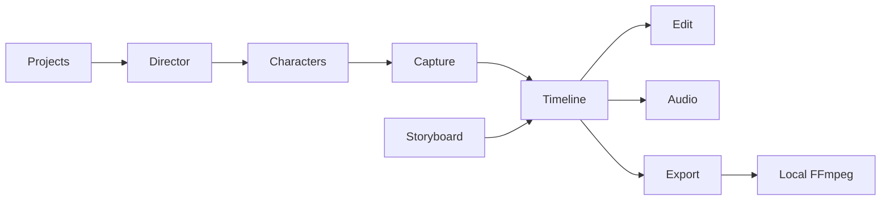

# Developer status — Global Film Director

Handoff for engineers picking up [envisionproductions316/globalfilmdirector](https://github.com/envisionproductions316/globalfilmdirector).

Design source: [Figma `ybDQ62Q6oBo1W8HkDJyJV4`](https://www.figma.com/design/ybDQ62Q6oBo1W8HkDJyJV4). Shell layout rules live in [`AGENTS.md`](../AGENTS.md).

## Verdict

Local studio is usable end-to-end on this machine: create a project, capture a raw take, place it on the shared timeline, edit/mix, and export an MP4 when FFmpeg is on PATH. Cloud AI, retargeting, and related connectors stay honestly unavailable.

Default URL: **http://127.0.0.1:5180**

## How to run

Requirements: **Node.js 20+**, **FFmpeg + ffprobe on PATH** (export only), Chromium-based browser for Capture.

```bash
npm install
npm run build
npm start
```

Open http://127.0.0.1:5180

Development:

```bash
npm run dev
```

LAN bind (optional):

```bash
# Windows PowerShell
$env:HOST="0.0.0.0"; npm start

# macOS / Linux
HOST=0.0.0.0 npm start
```

### Readiness gate

```bash
npm run ready
```

Runs typecheck, unit tests, production build, and `npm run check` (Node + build artifact + FFmpeg).

| Script | Purpose |
|--------|---------|
| `npm run dev` | Dev server (default `127.0.0.1:5180`) |
| `npm run build` | Production build (`output: "standalone"`) |
| `npm start` | Standalone production server ([`scripts/start-production.mjs`](../scripts/start-production.mjs)) |
| `npm run typecheck` | `tsc --noEmit` |
| `npm test` | Timeline / continuity unit tests |
| `npm run check` | Build + FFmpeg presence |

### Docker (self-host)

Export needs a Node process that can spawn FFmpeg. Not a static or serverless-only deploy.

```bash
docker build -t global-film-director .
docker run --rm -p 5180:5180 global-film-director
```

## Architecture (short)

- Next.js 15 App Router + React 19 + Tailwind v4
- Studio state: `localStorage` key `gfd.studio.v1` (schema v3) via [`lib/studio.tsx`](../lib/studio.tsx)
- Media blobs: IndexedDB `gfd-media` via [`lib/media-db.ts`](../lib/media-db.ts)
- Shell: header destinations + asset rail + context inspector ([`components/AppShell.tsx`](../components/AppShell.tsx))
- Shared timeline across Edit and Audio; Export encodes that timeline through [`app/api/export/route.ts`](../app/api/export/route.ts) + [`lib/export-jobs.ts`](../lib/export-jobs.ts)



## Subsystem status

| Area | Status | Notes |
|------|--------|-------|
| Projects | Done | Create / switch / delete / local save |
| Director | Done (local) | Notes + plan approval; APG not connected |
| Characters + Visual Styles | Done | Passport, shot assignments, styles rail |
| Locations | Done | Derived from scenes/shots; opens Storyboard |
| Capture | Done (raw camera) | 5-step Character Mirror; character-scoped placeTake; Tools Add via `captureAction` |
| Storyboard | Done | Shots / Sequence / Scene / Continuity / Graph |
| Edit | Done | Multitrack timeline, import, captions, SequencePlayer |
| Audio | Done | Same timeline; mix; narration; Music/SFX preferred import track |
| Export | Done (local FFmpeg) | Probe + encode H.264/AAC MP4; sample queue rows labeled |
| Connectors | Catalog only | Marketplace / routing / readiness; all Not connected |

## Intentionally not live

Do not implement UI that pretends these work until they are installed and tested:

- APG, GCIE, Envision Cloud
- MediaPipe face/body/hand tracking
- Motion retargeting / Live Sync / mirrored character preview
- Wireless phone camera
- AI lip-sync / expression / regenerate-motion tools
- Blender / ComfyUI workers

## Recent handoff highlights

- Capture studio shell aligned with design regions (header destinations, asset rail, inspector tools)
- Take selection scoped to the active character before timeline placement
- Standalone production start (do not use `next start` with `output: "standalone"`)
- README rewritten for install / run / Docker (was Figma-only stub)

## Verify before merge or demo

- [ ] `npm run ready` passes
- [ ] `/projects`, `/capture`, `/edit`, `/export`, `/api/export`, `/icon.svg` return 200
- [ ] Capture: Tools → Add to Timeline shows an on-screen message (`data-testid=capture-message`)
- [ ] Export page shows FFmpeg status when FFmpeg is installed
- [ ] Connectors / Capture still say unavailable systems are not connected
